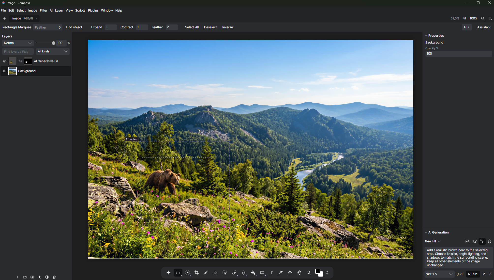
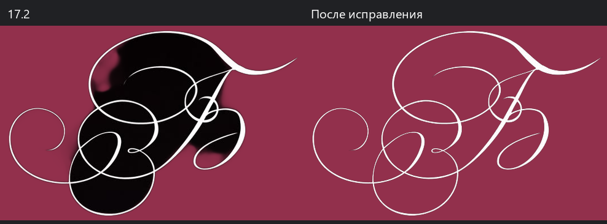
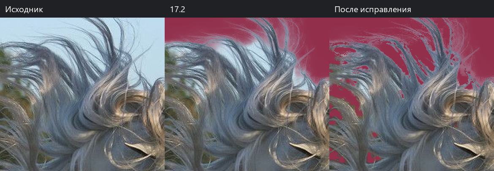

# Composa Studio

Composa Studio is a layer-based image editor for Windows and Linux. Combine photographs, editable text, and vector shapes in one project, cut out subjects with fine hair, and retouch the background. Object selection runs on your computer. Use generative fill, object removal, and canvas expansion with a ComfyUI workflow or a configured direct image connection.



## Download Studio 17.3 preview

| Platform | Download |
| --- | --- |
| Windows x64 | [Installer](https://github.com/alvasafin-art/Composa/releases/download/v1.3.0-preview.4.studio.17.3/composa-1.3.0-preview.4.studio.17.3-win-x64-setup.exe) · [Portable ZIP](https://github.com/alvasafin-art/Composa/releases/download/v1.3.0-preview.4.studio.17.3/composa-1.3.0-preview.4.studio.17.3-win-x64.zip) |
| Windows ARM64 | [Installer](https://github.com/alvasafin-art/Composa/releases/download/v1.3.0-preview.4.studio.17.3/composa-1.3.0-preview.4.studio.17.3-win-arm64-setup.exe) · [Portable ZIP](https://github.com/alvasafin-art/Composa/releases/download/v1.3.0-preview.4.studio.17.3/composa-1.3.0-preview.4.studio.17.3-win-arm64.zip) |
| Linux x86-64 and ARM64 | Choose the AppImage, DEB, RPM, or `.tar.gz` for your architecture from the [release downloads](https://github.com/alvasafin-art/Composa/releases/tag/v1.3.0-preview.4.studio.17.3). |

For a portable Windows installation, extract the entire ZIP and run `composa.exe`. On Linux, mark the AppImage as executable before opening it. The packages include the .NET runtime and local selection models. In **Settings → Editor**, you can switch between English and Russian, choose a theme, and configure GPU acceleration for object selection. [Release notes and checksums](https://github.com/alvasafin-art/Composa/releases/tag/v1.3.0-preview.4.studio.17.3)

## Working with layers

Open a photograph with **Ctrl+O** or create a canvas with **Ctrl+N**. Drag another image from your file manager onto the canvas to place it on a new layer. Save your working document as a **.cmps** project to keep its layers, text, and masks editable.

- **Arrange a composition.** Group related layers, adjust opacity, and choose a blend mode. Press **Ctrl+T** and drag anywhere inside the transform frame to move a layer, even through a transparent gap between letters. Use guides and numeric fields for precise placement.
- **Edit type and vector shapes.** Preview fonts on the canvas, format individual characters, and adjust tracking and line spacing. Use the Pen tool to edit points and curves. A shape's fill and stroke can each have their own gradient.
- **Retouch and adjust color.** Use the Brush, Clone Stamp, or Spot Healing tool on the active layer. An active selection limits the edit to that area. Adjustment layers and smart filters let you revisit an edit later. Documents support 8-bit and 16-bit RGB and ICC color profiles.
- **Export or continue in Photoshop.** Export the finished composition as PNG or JPEG. For layered work, export a PSD and review the conversion report to see which elements need rasterizing. On Windows, you can also send an open document directly between the two applications. [Photoshop exchange scripts](https://github.com/alvasafin-art/Composa/blob/main/docs/photoshop-exchange.md)

## Cutting out subjects and lettering

1. Choose **Object Selection → Automatic · Local**. Click a subject or drag a box around it. To select a single letter, click one of its strokes. To select a word, include every letter in the box. If several objects fit inside, a tighter box helps identify the one you want.
2. Press **Ctrl+J** to copy the selection to a new layer. Hide the original layer and place a contrasting color beneath the cutout to inspect openings in lettering and gaps between strands of hair.
3. Open **Select and Mask** for finer control. Use the preview to adjust edge softness and reduce color picked up from the original background.

EfficientSAM finds the subject and ViTMatte refines opacity along its edges. On Windows, both use a supported GPU through DirectML by default. If the driver cannot run a model, Composa retries it on the CPU. To force CPU processing, turn off GPU acceleration in **Settings → Editor**. On Linux, both models run on the CPU. [Object selection guide](https://github.com/alvasafin-art/Composa/blob/main/docs/object-selection-models.md)

**Calligraphy.** Both cutouts below started with the same click on a white stroke of the Cyrillic letter *Б*. The burgundy background shows where Studio 17.3 preserved the openings inside its loops.



**Fine hair.** In the horse's mane, more of the new background shows through the gaps between strands in Studio 17.3. Some translucent hairs still carry a tint from the sky or foliage.



## Generative tools and the assistant

Choose an executor for each operation in **Settings → Image generation**. ComfyUI uses the model and workflow configured in **Image models** and **Workflows**. A direct image connection can use a locally signed-in Codex CLI with access to image generation, an OpenAI Images-compatible endpoint, OpenRouter, or Polza AI, depending on the model and operation. Enter your own API URL, model ID, and key when using a direct API. Real-ESRGAN and Polza Topaz are available for ×2 or ×4 upscaling. Object Selection and Select Subject can also use rembg or the fal BiRefNet API.

In **Settings → Prompt enhancer**, choose the text connection separately. A local Codex CLI or compatible Chat Completions API can rewrite the prompt while ComfyUI generates the image. Server-based options use Comfy credits or AVS Prompt Helper, depending on the route.

To replace part of a photograph, select the area, describe the change in the generation panel, and click **Run**. For Generative Expand, extend the crop beyond the canvas. Masked expansion keeps the original outside the blend margin. When assigning an imported expansion workflow, bind the prepared canvas and grayscale expansion mask, and return a frame that matches the prepared canvas. You can compare variants and undo the expansion in one step. ComfyUI workflows require their server nodes and model files. Cloud routes may incur charges. [Image models and connections](https://github.com/alvasafin-art/Composa/blob/main/docs/ai-models.md)

The **Assistant** panel connects separately to a local model through llama.cpp or to an OpenAI-compatible API. The assistant can inspect the current document and run editor commands. Its settings control which folders it can access and whether it receives a canvas preview. [Assistant setup](https://github.com/alvasafin-art/Composa/blob/main/docs/assistant-setup.md)

## Building from source

Install the .NET 10 SDK and run the following commands from the repository root. The first command downloads the selection models and verifies their checksums. It requires Bash, available on Windows through Git Bash.

```sh
bash scripts/models/fetch.sh
dotnet run --project src/Composa.App
```

Run the test suite with `dotnet test Composa.slnx`. [Packaging and release instructions](https://github.com/alvasafin-art/Composa/blob/main/RELEASING.md)

[User guide](https://github.com/alvasafin-art/Composa/tree/main/docs) · [Keyboard shortcuts](https://github.com/alvasafin-art/Composa/blob/main/docs/shortcuts.md) · [Changelog](https://github.com/alvasafin-art/Composa/blob/main/CHANGELOG.md) · [License](https://github.com/alvasafin-art/Composa/blob/main/LICENSE)
