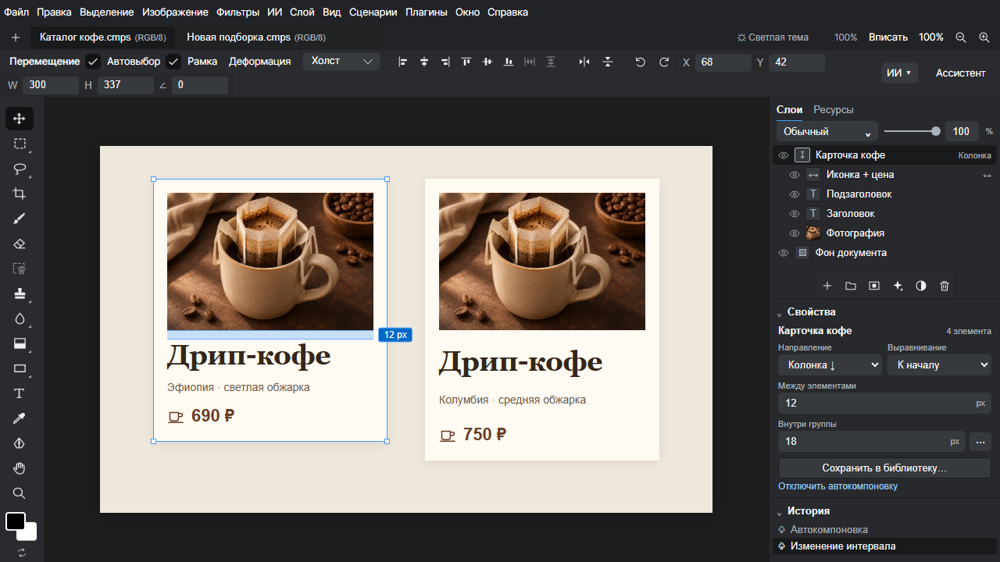
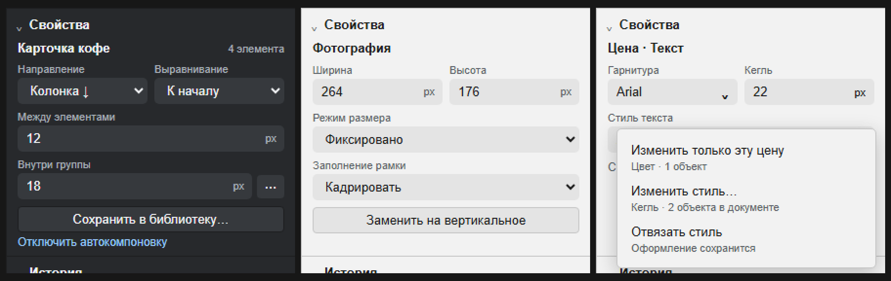

# Автокомпоновка, стили и библиотека Composa Studio

Черновик для согласования интерфейса. Откройте [index.html](index.html) из рабочей копии в браузере. Прототип запускается локально, без сервера и установки пакетов. Размер окна редактора в макете — 1280 × 720. Переключатель темы находится рядом с масштабом.

[Светлая тема](review/03-light.png) · [Слои до группировки](review/01-before.png) · [Предпросмотр](review/11-preview.png) · [Перенос заголовка](review/04-wrap.png) · [Вставленная карточка](review/08-inserted.png) · [Возврат к кисти](review/09-brush.png)

## Сценарий

1. Нажмите **Автокомпоновка** в «Свойствах». Предпросмотр предложит колонку из четырёх выбранных элементов и исходный интервал 20 px. Нажмите **Применить**. Порядок на холсте — фотография, заголовок, подзаголовок, вложенная горизонтальная строка цены. Панель «Слои» показывает стопку в обычном порядке редактора, сверху вниз.
2. Нажмите синее число рядом с промежутком между фото и заголовком. Введите **12** и нажмите Enter. Промежуток также меняется перетаскиванием и полем «Между элементами» в «Свойствах». Перетащите строку цены к заголовку и отпустите над синей линией вставки. **Ctrl+Z** вернёт исходный порядок.
3. Выберите «Заголовок» и нажмите **Редактировать на холсте**. Допишите « из Эфиопии» и нажмите Enter. Заголовок займёт две строки, а подпись и цена опустятся. Выберите «Фотография», чтобы сравнить фиксированную рамку и размер по содержимому. Увеличение ширины «Иконки» во вложенной строке сдвинет цену.
4. Раскройте строку «Иконка + цена», выберите «Цена» и откройте «Стиль текста». **Изменить только эту цену** задаёт локальный цвет. **Изменить стиль…** заранее показывает, что новый кегль затронет обе цены каталога. Локальный цвет при этом сохранится.
5. Выберите «Карточка кофе» и нажмите **Сохранить в библиотеку…**. Откройте «Новая подборка.cmps». Найдите карточку во вкладке «Ресурсы» и нажмите на её миниатюру, нажмите Enter на миниатюре или перетащите её на холст.
6. Выберите «Кисть» слева или нажмите **B**. Свойства фотографии возвращаются к непрозрачности, а на фото появляется курсор кисти.

## Увеличенные «Свойства»

[Группа, фотография и выбор области действия стиля, увеличение 200%](review/properties-2x.png)

[Ресурсы перед вставкой](review/07-resources.png) · [Тёмная тема с кистью](review/10-brush-dark.png)

## Основа и границы прототипа

Взяты [тёмный](assets/studio-dark.png) и [светлый](assets/studio-light.png) снимки штатного окна из `EditorThemeTests` Composa Studio 17.6, коммит `42f5ea0`. Меню, панель инструментов, цветовые образцы и действия внизу панели слоёв используют фрагменты этих кадров. Демонстрационный каталог содержит две карточки с общим стилем цены. Фото создано встроенным ImageGen. [Фотография](assets/coffee.jpg)

> Горизонтальная предметная фотография для карточки дрип-кофе. Крупный план бежевой керамической чашки с бумажным дрип-фильтром на тёплой тёмной столешнице, мягкий боковой свет и видимая фактура бумаги. Чашка и фильтр полностью помещаются в центральном кадре. Палитра от кремового до кофейно-коричневого. Без текста и логотипов. Исходных изображений для этой фотографии нет.

Состояние демо хранится на время открытия вкладки. Документы CMPS, папка библиотеки и мазки кисти представлены как интерфейсные состояния. Реализация в редакторе следует после утверждения дизайна.

Проверено в Microsoft Edge при 1280 × 720 в обеих темах. Проверка прошла через сохранение геометрии при группировке и отмене предпросмотра, точный ввод и перетаскивание интервала, перестановку строки и Undo, перенос заголовка, изменение размера фото и иконки, локальное переопределение цены, изменение общего кегля, поиск ресурса, вставку с клавиатуры и перетаскиванием и переход к кисти.

## Автокомпоновка в редакторе

Выделите слои одного родителя и нажмите **Автокомпоновка** в «Свойствах» или в контекстном меню слоёв. Синие контуры показывают предложенные позиции. После применения наведите курсор на промежуток. Перетащите выделенную полосу для изменения интервала или нажмите число, введите значение и подтвердите его клавишей Enter. Перетаскивание элемента внутри выбранной группы показывает линию вставки. Ctrl+G создаёт обычную группу.

[Группа в тёмной теме, 1280 × 720](review/editor-group-dark.png) · [Светлая тема](review/editor-group-light.png) · [Свойства фотографии](review/editor-photo.png) · [Линия вставки](review/editor-insertion-line.png) · [Кисть](review/editor-brush.png) · [Окно 1920 × 1080](review/editor-group-1920.png)

[Короткий ролик из кадров редактора](review/editor-gestures.webm) показывает изменение интервала, линию вставки и возврат к кисти.

Формат CMPS 17 сохраняет правила автокомпоновки и рамку изображения. В PSD экспортируются позиции и вид слоёв. Разделы общего стиля и библиотеки относятся к следующим этапам.

[Результаты проверок и замеров](verification.md)
