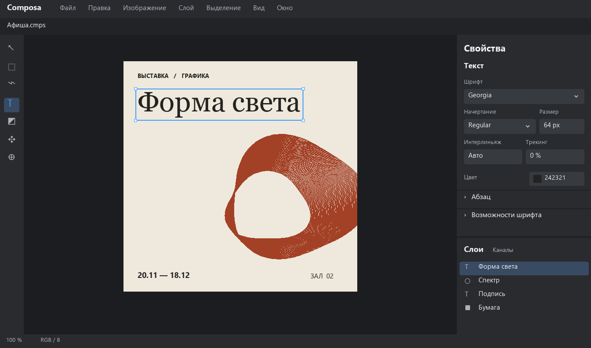
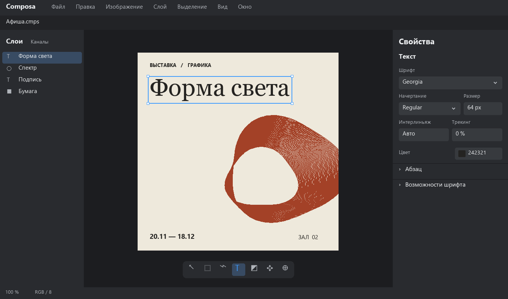
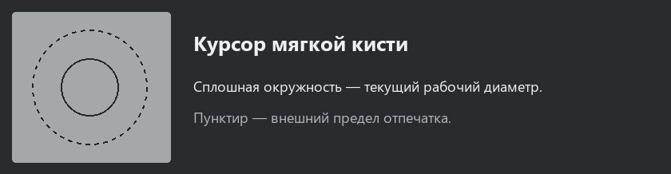

# Текст, свойства и курсор кисти

Предложение от 20 ноября 2026 года. Для обсуждения в ветке `codex/text-properties`. Утверждение компоновки предшествует реализации. Русские подписи на макетах служат для согласования.

После обсуждения составлена [новая рекомендация по взаимодействию](interaction.md) и подготовлен [кликабельный прототип](workspace.html). Варианты А и Б ниже сохранены для сравнения. Перечень требований к тексту и кисти по-прежнему актуален.

## Рабочее пространство

**А. Один правый док.** При выборе текстового слоя открываются его свойства, даже если активен инструмент перемещения. Семейство, начертание, кегль, цвет и интервалы доступны сразу. Разделы «Абзац» и «Возможности шрифта» раскрываются по нажатию. Высота списка слоёв регулируется разделителем. Длинный инспектор прокручивается отдельно. На низком экране свойства можно свернуть. Существующие историю, каналы и навигатор по-прежнему можно открывать в доке. Для режима ввода сохраняются явные действия завершения и отмены.

**Б. Две колонки.** Слои занимают всю высоту слева, свойства — справа. Инструменты сгруппированы внизу по центру. Длинный список слоёв остаётся виден при раскрытом инспекторе. При том же размере окна рабочая область уже. В макете показан сокращённый набор инструментов.

Предпочтительный первый вариант — А. Он даёт место типографике и сохраняет привычные позиции инструментов и слоёв. Смена текстового слоя должна обновлять значения на месте, сохраняя ширину панелей, прокрутку и раскрытые разделы.

## Живой выбор шрифта

- Подсвеченная строка открытого списка сразу показывает семейство на самом холсте. Стрелки меняют активную строку. Наведение мыши даёт тот же результат. При прокрутке колесом обновлять образец, когда под указатель попадает новая строка.
- Если выделены символы, примерять семейство к выделению. Для выбранного текстового блока без выделения символов примерять его ко всему блоку. Сохранять цвет, размер и подбирать ближайшее начертание для каждого фрагмента.
- Клик или Enter принимает текущую строку. Escape или закрытие списка без выбора восстанавливает исходные семейства, выделение и позицию ввода. Закрытие списка по Escape во время набора не должно отменять весь ввод. Переход к другому документу или слою сбрасывает временный образец.
- Просмотр оставляет историю и признак изменения документа прежними. После подтверждения один Undo возвращает исходное оформление.
- Предлагаемая цель для проверки — на машине с экраном 60 Гц для уже загруженного шрифта 95% обновлений обычного блока укладываются в 16,7 мс от смены строки до готового кадра. Отдельно записать задержку первого обращения, результаты для длинного многострочного текста и большой библиотеки шрифтов. При быстром листании показывать последнюю активную строку, отбрасывая устаревшие запросы. Цель требует измерения на реальной сборке.

## Состав типографики по референсам

| Группа | Что предусмотреть |
| --- | --- |
| Интервалы | Уже есть интерлиньяж в px с автоматическим режимом и трекинг в px. Явно показать «Авто», добавить относительный трекинг в процентах от кегля. Существующие значения проектов сохранить в их единицах. |
| Рамка | Вертикальная привязка к верху, центру или низу текстовой рамки. Для свободного однострочного текста эта настройка имеет смысл после задания высоты. |
| Абзац | Существующие левый, центральный и правый режимы, выключка по ширине, интервал между абзацами, абзацный отступ. Маркированные и нумерованные списки, висячие списки и висячая пунктуация. |
| Границы текста | Вертикальная подрезка по метрикам букв (vertical trim), режимы переноса строк, усечение с многоточием. Исходный текст остаётся доступен для редактирования. |
| Оформление | Подчёркивание, зачёркивание и возврат к обычному виду. Преобразование регистра, включая прописные, строчные, начальные прописные и капитель при поддержке шрифтом. Сохранять исходную строку. |
| Возможности шрифта | Регистрозависимые формы, интервалы прописных, стили цифр и позиции цифр (обычные, верхние, нижние). Предлагать поддерживаемые шрифтом варианты. Для вариативных семейств показывать доступные оси, их названия и диапазоны. В референсе видна вкладка Variable, её содержимое требует согласования. |
| Образец | Выбранный текст на холсте служит основным образцом. В расширенном разделе предложен компактный образец для сравнения мелких отличий цифр, регистра и осей. |

При реализации сверить набор подменю оформления и переноса с пользователем, поскольку на скриншотах они закрыты. Проверить смешанные стили и кириллицу, редактирование и Undo, сохранение и повторное открытие CMPS, вид при экспорте и чтение старых проектов.

## Кисть

Сохранить текущую рабочую окружность. Добавить тонкий контрастный пунктир по внешнему пределу отпечатка при текущем размере и нажиме, с учётом масштаба холста. Граница должна соответствовать области, до которой может дойти отдельный отпечаток. Она не зависит от цвета под кистью. Использовать ту же геометрию, что и движок кисти. При жёсткой кисти или включённом полном курсоре окружности могут совпасть. Предложение — рисовать один контур в месте совпадения. Проверить мягкую и жёсткую кисти, планшет, разные масштабы и читаемость на светлом и тёмном фоне.
