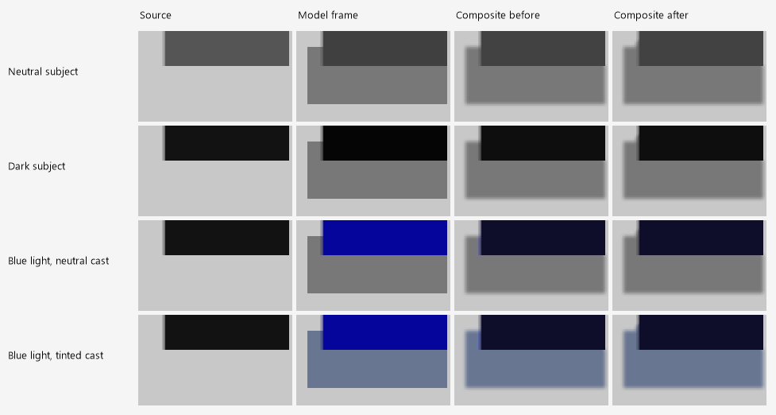

# Harmonize shadow color validation

The synthetic model frames use the document's source alpha to combine a relit foreground with known ground RGB. In the blue-light case with neutral ground shading, the old extractor recovered RGB (115, 115, 173) under the soft edge from a true ground value of (120, 120, 120). With Preserve Details off, it recovered (113, 113, 185). The floor farther from the subject was already neutral. The tests check the recovered ground both inside the cast and under the edge, half-strength blending, the unchanged foreground alpha, and an intentionally tinted cast at RGB (105, 118, 145).

The permission mask allows a shadow under semitransparent subject pixels. Those same pixels had also been treated as ground measurements after subtracting estimated subject relighting. The detail-preserving gains intentionally limit how much a channel can change, which left some of the new subject color in that subtraction. Disabling Preserve Details skipped the lighting estimate and left more of the new subject color in the shadow. At the mixed edge, dividing by the fraction of visible floor amplified the residual. The editable Normal layer then reproduced that residual on the document.

Harmonize and Match to Scene now measure ground only where alpha leaves it fully visible and the model result is opaque. Background calibration still removes the global model grade against the reconstructed reference where available. The accepted cast's premultiplied color and coverage extend a short distance under the permitted fringe before smoothing. This keeps the original foreground alpha and retains local cast hue. The Display P3 test checks the result through the editor's final layer insertion and document renderer.

## Saved model responses

Eight existing FLUX and Qwen frames were processed twice using identical source, alpha, permission, generated image and model reconstruction. The final composite used the editor's scene insertion path. The table reports the 95th percentile of the range of per-channel RGB changes in 8-bit sRGB. Raw changes are measured against the reconstruction and final changes against the original composite. Samples have shadow alpha of at least 8 and subject alpha at most 128. Ground samples are outside the subject and farther than two pixels from its alpha along either axis. The percentile describes the color change in the particular replay, including background calibration or registration effects.

| Model | Scene | Raw ground | Final ground before → after | Final edge before → after |
| --- | --- | ---: | ---: | ---: |
| FLUX | Indoor sun | 120 | 117 → 117 | 103 → 102 |
| FLUX | Indoor diffuse | 37 | 35 → 35 | 58 → 59 |
| FLUX | Outdoor sun | 53 | 36 → 36 | 59 → 63 |
| FLUX | Outdoor overcast | 10 | 15 → 15 | 71 → 61 |
| Qwen | Indoor sun | 61 | 66 → 66 | 40 → 36 |
| Qwen | Indoor diffuse | 40 | 49 → 49 | 57 → 62 |
| Qwen | Outdoor sun | 48 | 44 → 44 | 27 → 28 |
| Qwen | Outdoor overcast | 8 | 6 → 6 | 46 → 34 |

Ground-darkening percentiles were identical before and after in all eight replays. Subject alpha matched exactly. Contact registration stayed at the same displacement in seven frames and moved one additional pixel vertically for Qwen indoor sun. Some model frames already contained strong ground color changes, including FLUX indoor sun. Fresh provider generations were outside this validation.
